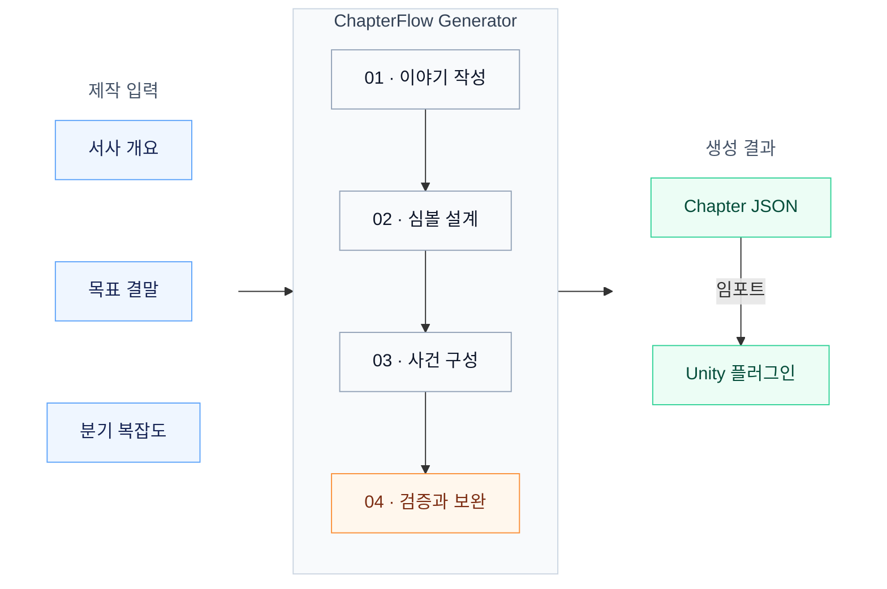

<h1 align="center">ChapterFlow Generator</h1>

<p align="center">
  <strong>서사 개요에서 게임용 분기 챕터까지</strong><br>
  전체 이야기를 바탕으로 사건·심볼·진행 규칙을 구성하는 AI 챕터 생성기
</p>

<p align="center">
  <a href="LICENSE"></a>
  
  
</p>

<p align="center">
  <a href="#빠른-시작">빠른 시작</a> ·
  <a href="#생성-흐름">생성 흐름</a> ·
  <a href="#출력과-unity-연결">출력 규격</a> ·
  <a href="https://github.com/Evolutionary-Game-LAB/ChapterFlow-unity">Unity 플러그인</a>
</p>

---

**ChapterFlow Generator**는 서사 개요와 원하는 결말을 입력받아, 게임에서 실행 가능한 분기 챕터 JSON을 생성하는 TypeScript 기반 도구. ChapterFlow의 생성 파이프라인과 로컬 CLI를 포함한 저장소이며, 웹 편집 UI는 별도 구성.

## 주요 기능

| 기능 | 내용 |
| --- | --- |
| **전체 이야기 기반 생성** | 입력 개요와 결말을 기준으로 인물의 행동과 사건의 인과관계를 먼저 구성 |
| **분기 복잡도 선택** | `low` · `medium` · `high`에 따른 분기·합류 확장 수준 조절 |
| **게임 규칙 구성** | 필요한 심볼, 초기 상태, 허용된 변화, 사건 진입 조건과 결말 조건 설계 |
| **검증과 복구** | 생성 결과의 구조·실행 조건·서사 일관성 검사 및 오류 보완 |
| **엔진 연동** | 생성된 JSON을 Unity 플러그인으로 가져와 게임플레이에 연결 |

## 생성 흐름

전체 이야기에서 필요한 상태를 추출하고, 이를 사건과 게임 규칙으로 변환하는 흐름.



핵심 경로의 유효성을 유지하면서 복잡도에 따른 추가 분기를 시도하는 방식. 복잡도는 생성 선호 수준이며, 정확한 노드 수나 분기 수의 지정값은 아님.

## 빠른 시작

**필요 환경:** Node.js 22 · npm · 사용 가능한 LLM API 계정

### 1. 설치와 입력 검사

```sh
git clone https://github.com/Evolutionary-Game-LAB/ChapterFlow-generator.git
cd ChapterFlow-generator
npm ci
npm run generate -- examples/request.json --validate-only
```

`--validate-only`는 요청 JSON의 형식 검사만 수행하는 옵션. 외부 API 호출과 생성 비용 없음.

### 2. 생성 요청 설정

[examples/request.json](examples/request.json)에서 개요·결말·모델 설정 편집.

| 항목 | 설정 |
| --- | --- |
| `brief` | 배경, 인물, 사건 개요와 원하는 결말 |
| `branchComplexity` | `low` / `medium` / `high` — 예제 기본값 `medium` |
| `settings.endpoint` | 사용하는 API의 기본 URL |
| `settings.model` | 해당 API 계정에서 사용할 수 있는 모델 ID |
| `settings.temperature` | 모델 요청에 사용할 생성 온도 |

공개 CLI의 실행 범위는 `operation: "create"`, `settings.mode: "openai-compatible"` 조합의 API 챕터 생성.

### 3. API 키 입력과 생성

API 키 전달 경로는 환경 변수 `LLM_API_KEY`. 요청 JSON의 `settings.apiKey` 입력은 거부 대상.

PowerShell 7에서 키를 가리고 입력한 뒤 생성하는 예시:

```powershell
$env:LLM_API_KEY = Read-Host 'LLM API key' -MaskInput
npm run generate -- examples/request.json story.json
Remove-Item Env:LLM_API_KEY
```

성공 시 `story.json` 저장. 기존 출력 파일 덮어쓰기 방지, 실패·취소 시 완성 파일 미저장. 실제 생성은 유료 API 호출이며, 비용은 선택 모델과 생성·복구 호출량에 따라 변동.

## 출력과 Unity 연결

출력 형식은 `schemaVersion: "0.6"`의 전체 Story JSON. 엔진 실행 기준은 최상위 `gameplay`의 `chapter-gameplay-v1` 규격.

| 영역 | 역할 |
| --- | --- |
| `symbolic` · `chapter` | 이야기와 사건을 구성하는 작성 데이터 |
| `gameplay` | 초기 상태, 사건, 허용 신호, 진입 조건과 연결 등 런타임 실행 규칙 |

**연동 순서:** JSON 생성 → [ChapterFlow Unity](https://github.com/Evolutionary-Game-LAB/ChapterFlow-unity)로 임포트 → 게임 행동과 사건 시작·종료 신호 연결.

- [실행 규칙](CONTRACT.md) — 상태 변경과 사건 진행의 의미
- [JSON Schema](schemas/chapter-gameplay-v1.schema.json) — 런타임 데이터 구조
- [기차역 예제](public/examples/chapterflow-station.json) — 기존 생성 결과의 형식 확인용 샘플

## 개발과 검증

```sh
npm run typecheck
npm test
```

| 진입점 | 역할 |
| --- | --- |
| [cli.mts](cli.mts) | 요청 로딩, API 키 전달, 결과 파일 저장 |
| [server/chapter-generation.ts](server/chapter-generation.ts) | 생성 파이프라인 선택과 공통 진입 |
| [server/joint-story-generation.ts](server/joint-story-generation.ts) | API 새 챕터 생성의 기본 파이프라인 |

이전 `legacy`·`story-first` 구현은 비교·재현 및 내부 의존성을 위해 보존. 기본값 외 경로는 연구용 환경 변수 `CHAPTER_PIPELINE`으로 선택.

<details>
<summary><strong>검증 범위와 현재 한계</strong></summary>

- 2026-11-03 공개 준비 기준: 타입 검사, CLI 요청 검사, 생성기 실행 회귀 테스트 19개 통과 기록
- 저장된 챕터를 이용한 웹·Unity 실행 비교 결과는 [VALIDATION.md](VALIDATION.md)에 기록
- 위 검증은 새로운 LLM 전체 생성의 성공률·품질 측정과 별개
- 모델·입력에 따른 생성 실패 및 서사 개연성 오류 가능성, 게임 적용 전 검토 필요
- 현재 생성 요청 상한 45분 — 평균 생성 시간이나 완료 보장 시간이 아닌 취소 기준
- 웹 편집기, 중간 경로 복원 UI, 공개 호스팅 서버는 이 CLI의 제공 범위 밖

</details>

## 관련 프로젝트와 문의

- [ChapterFlow Unity](https://github.com/Evolutionary-Game-LAB/ChapterFlow-unity) — 생성된 챕터의 Unity 런타임
- [Issues](https://github.com/Evolutionary-Game-LAB/ChapterFlow-generator/issues) — 오류 제보와 기능 제안
- 오류 제보 시 모델명·재현 절차·민감정보를 제거한 최소 입력 포함 권장

## 라이선스

[Apache License 2.0](LICENSE) 적용. 외부 의존성의 개별 라이선스 및 목록은 [THIRD-PARTY.md](THIRD-PARTY.md) 참조.
